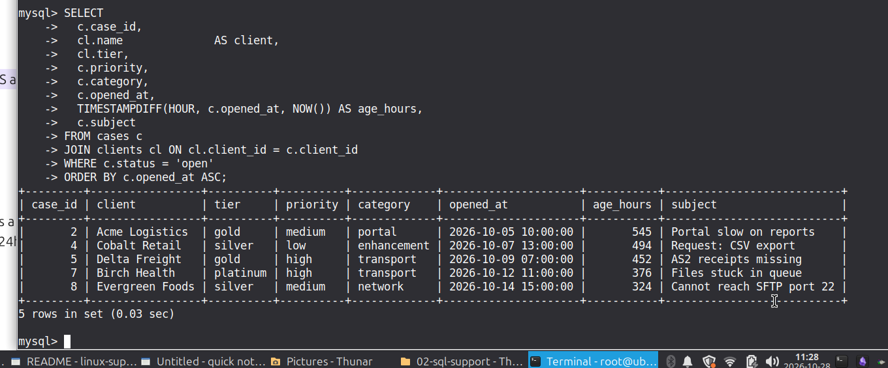
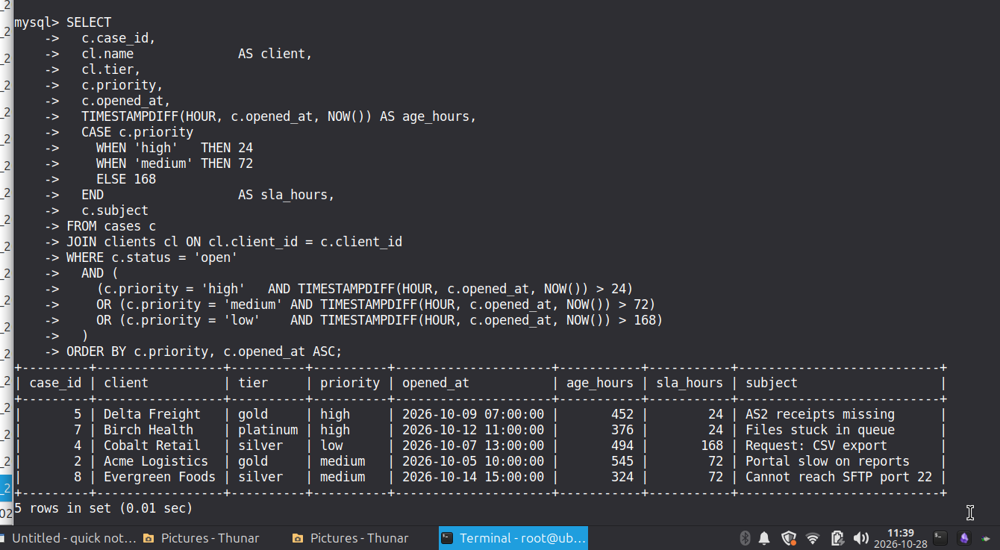
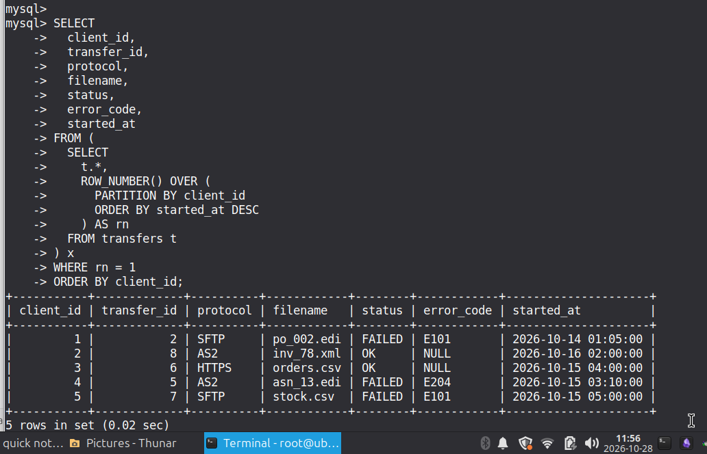
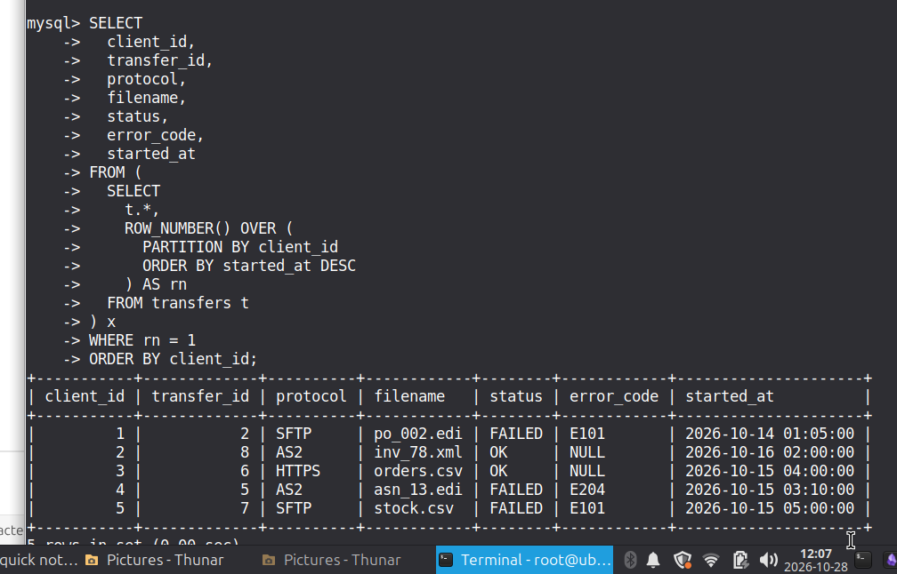
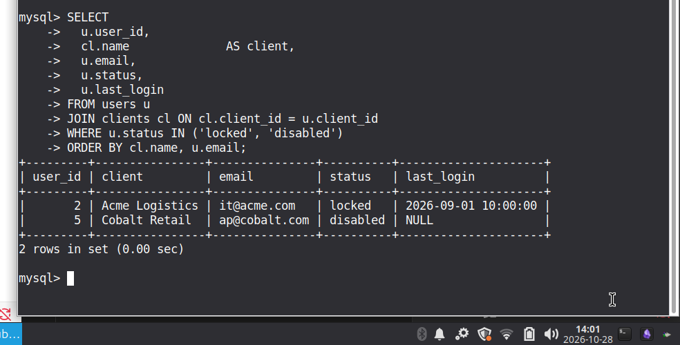

# MySQL Support Queries — Evidence
This folder contains the support-triage SQL queries used in my lab 
(`mysql-support-queries.sql`).

Below is the visual evidence of the queries running against the lab database.

>  Lab Infrastructure & Environment

This project was fully engineered and deployed within a **self-managed Ubuntu Server lab environment** utilizing **Docker containers** for microservices isolation.

- **Host OS:** Ubuntu Server (`root@ubuntuserver`)
- **Container Engine:** Docker Engine - Community (v29.9)
- **Database Engine:** MySQL 8.0 Community Server (Running via Docker container: `sql-lab-mysql-1`)
- **Data Privacy:** All hostnames, user credentials, and PII are strictly **synthetic/mock data** to mirror enterprise data-sanitization standards.

Dataset Scale & Stress Testing

The database schema populates standard operational tables (`clients`=5, `users`=8, `cases`=8) alongside a **~500,000-row bulk transfer table (`transfers_bulk`)** explicitly generated to test query optimization, indexing, and container resource limits under heavy loads.

## 0. Sanity Checks

**0.1 Confirm you're on the right server and database**

**0.2 Row counts**

## 1. Open and Overdue Cases
**1.1 All open cases, oldest first**

**1.2 Overdue open cases**
threshold by priority is a business
--     rule; adjust per contract. This version: high > 24h,
--     medium > 72h, low > 168h.

## 3. Transfer Triage

- 3.3 Latest transfer per client.
--     MySQL 8 window function — replaces the old
--     correlated-subquery trick and is faster and clearer.

**3.3 Latest transfer per client (Window function)**
--     correlated-subquery trick and is faster and clearer.

## 4. User and Access Triage
**4.1 Locked or disabled users**

**4.3 Users who have never logged in**
Distinct from "inactive"

- 7.1 Pattern: SELECT first.
--     Find the exact rows you intend to change.

